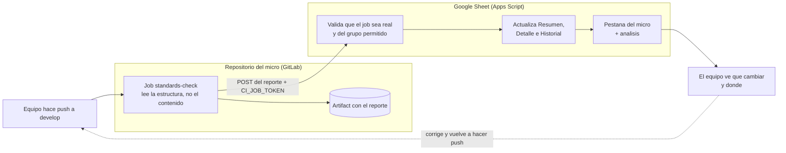

# PR241 · Arquitectura

**Comunicación entre capas con arquitectura hexagonal — estándar unificado para los microservicios de los PRS**

---

## Propósito

Estándar hexagonal para los microservicios Java / Spring de los PRS. El dominio y los casos de uso forman el
núcleo; REST, persistencia, clientes HTTP y almacenamiento son adaptadores. Usa la raíz
`pe.edu.vallegrande.{producto}.{contexto}` y agrega solo los componentes que el servicio use.

Unifica los documentos de arquitectura de PRS2 (Vía Academy), PRS3 (FideiNexus), PRS4 (SIGRC) y PRS5
(EduNova), que ya describen la misma estructura, y los complementa con las convenciones de nombres tomadas
del código real y con la verificación automática del estándar.

**Qué es obligatorio:** la estructura y las reglas de dependencia de este documento, y el job
`standards-check` en el pipeline del micro. Seguridad, documentación de API, base de datos, frontend y
despliegue los definen otros equipos con sus propios estándares; lo que aparece aquí sobre esos temas es
contexto, no requisito.

---

## Árbol estándar

```
vg-ms-{servicio}/
├── pom.xml
├── Dockerfile
├── README.md
├── .env.example                 # Variables de ejemplo; sin secretos reales
├── .dockerignore
├── .gitignore
└── src/
    ├── main/
    │   ├── java/pe/edu/vallegrande/{producto}/{contexto}/
    │   │   ├── {Servicio}Application.java
    │   │   ├── domain/
    │   │   │   ├── model/                    # Entidades y agregados del dominio
    │   │   │   ├── vo/                       # Value objects y enums del dominio
    │   │   │   ├── exception/                # Excepciones de negocio
    │   │   │   └── port/
    │   │   │       ├── in/                   # Contratos de casos de uso
    │   │   │       └── out/                  # Contratos de repositorio/client/storage
    │   │   ├── application/
    │   │   │   ├── usecase/                  # Una clase por accion de negocio
    │   │   │   ├── dto/
    │   │   │   │   ├── request/
    │   │   │   │   └── response/
    │   │   │   └── mapper/                   # Solo mapeos propios de aplicacion
    │   │   ├── infrastructure/
    │   │   │   ├── adapter/
    │   │   │   │   ├── in/
    │   │   │   │   │   └── rest/
    │   │   │   │   │       ├── controller/       # {Entidad}Rest
    │   │   │   │   │       ├── dto/
    │   │   │   │   │       │   ├── request/
    │   │   │   │   │       │   └── response/
    │   │   │   │   │       └── mapper/           # REST request/response <-> aplicacion
    │   │   │   │   └── out/
    │   │   │   │       ├── persistence/
    │   │   │   │       │   └── {tecnologia}/
    │   │   │   │       │       ├── entity/       # Modelo SQL; no es el modelo de dominio
    │   │   │   │       │       ├── document/     # Documento MongoDB; no es el modelo de dominio
    │   │   │   │       │       ├── repository/   # Spring Data
    │   │   │   │       │       ├── mapper/       # Dominio <-> entity/document
    │   │   │   │       │       └── {Entidad}PersistenceAdapter.java
    │   │   │   │       ├── client/
    │   │   │   │       │   └── {cliente}/
    │   │   │   │       │       ├── dto/          # Contratos HTTP externos
    │   │   │   │       │       ├── mapper/       # Dominio <-> DTO externo
    │   │   │   │       │       └── {Cliente}ClientAdapter.java
    │   │   │   │       └── storage/              # Solo si usa archivos
    │   │   │   ├── security/                     # Spring Security/JWT/JWE/filtros, si el servicio los usa
    │   │   │   ├── exception/
    │   │   │   │   ├── custom/                        # Excepciones tecnicas del adaptador
    │   │   │   │   ├── GlobalExceptionHandler.java
    │   │   │   │   ├── RestExceptionHandler.java      # Solo si hace falta
    │   │   │   │   └── ValidationExceptionHandler.java # Solo si hace falta
    │   │   │   └── config/                            # Configuracion concreta de Spring
    │   └── resources/
    │       ├── application.yml
    │       ├── application-dev.yml
    │       ├── application-prod.yml
    │       ├── db/migration/                 # Solo SQL con Flyway/Liquibase
    │       └── doc/
    │           └── {servicio}-collection.json  # Coleccion Postman
    └── test/java/pe/edu/vallegrande/{producto}/{contexto}/
        ├── domain/
        ├── application/
        └── infrastructure/
```

El árbol es el catálogo completo: conserva solo los paquetes que el servicio necesite. Un micro sin archivos
no crea `storage/`; uno sin clientes externos no crea `client/`. Los paquetes van en minúsculas, sin
snake_case: `pe.edu.vallegrande.edunova.welfare`, nunca `pe.edu.vg_ms.Welfare`.

Cada PRS define su `{producto}`: `viaacademy`, `fideinexus`, `sigrc`, `edunova`. Hoy hay micros fuera de esa
raíz, como `vallegrande.edu.pe.requestsservice` y `pe.edu.vallegrande.maestro.activity`; alinearlos es un
cambio de paquete que conviene hacer en un commit propio.

---

## Responsabilidades y dependencias

- `domain/model` y `domain/vo` contienen comportamiento y conceptos del negocio; no dependen de Spring, HTTP
  ni bases de datos.
- `domain/port/in` declara las acciones que ofrece el servicio. `domain/port/out` declara lo que el núcleo
  necesita de persistencia, clientes o storage.
- `application/usecase` implementa cada acción y coordina dominio y puertos. No conoce implementaciones
  concretas ni Spring Data.
- `infrastructure/adapter/in/rest` recibe HTTP, valida formato, mapea la solicitud y llama al caso de uso. No
  contiene reglas de negocio ni consulta el repositorio.
- `infrastructure/adapter/out` implementa los puertos de salida. El repositorio Spring Data es un detalle
  interno del adaptador de persistencia.
- Las dependencias apuntan hacia el núcleo: los adaptadores dependen de los puertos; el dominio no depende de
  infraestructura.

El puerto de salida es lo que sostiene la regla. El caso de uso recibe una interfaz que vive en el dominio
(`RequestRepositoryPort`) y no sabe si por detrás hay R2DBC o MongoDB. Sin puertos, el servicio termina
importando el repositorio de Spring Data y la dependencia se invierte.

```
  REST  ──▶  port/in  ──▶  usecase  ──▶  port/out  ◀──  Persistencia / Cliente / Storage
                              │
                              ▼
                        domain/model
```

---

## Mappers y modelos por frontera

| Frontera | Ubicación | Conversión |
|---|---|---|
| REST | `infrastructure/adapter/in/rest/mapper/` | Request/response HTTP ↔ modelo de aplicación o dominio |
| Persistencia | `infrastructure/adapter/out/persistence/{tecnologia}/mapper/` | Dominio ↔ Entity SQL o Document MongoDB |
| Cliente externo | `infrastructure/adapter/out/client/{cliente}/mapper/` | Dominio ↔ DTO propio del contrato externo |

El modelo de dominio, el modelo de base de datos, el DTO público y el DTO remoto representan fronteras
distintas. No reutilices entidades de base de datos como respuesta REST ni DTOs externos dentro del dominio.
Crea mappers cuando haya una transformación; si dos modelos son realmente iguales, no agregues un mapper
vacío.

---

## Convenciones de nombres

| Elemento | Convención | Ejemplo |
|---|---|---|
| Modelo de dominio | `{Entidad}` | `Request` |
| Value object / enum | `{Nombre}` | `RequestStatus` |
| Puerto de entrada | `{Entidad}UseCase` | `RequestUseCase` |
| Puerto de salida | `{Entidad}RepositoryPort`, `{Cliente}ClientPort`, `{Uso}StoragePort` | `RequestRepositoryPort` |
| Caso de uso | `{Entidad}Service` o `{Acción}{Entidad}UseCase` | `RequestService` |
| Controller REST | `{Entidad}Rest` (no `Controller`) | `RequestRest` |
| Entidad SQL | `{Entidad}Entity` | `RequestEntity` |
| Documento MongoDB | `{Entidad}Document` | `RequestDocument` |
| Repositorio Spring Data | `{Entidad}Repository` | `RequestRepository` |
| Adaptador de salida | `{Entidad}PersistenceAdapter`, `{Cliente}ClientAdapter` | `RequestPersistenceAdapter` |
| Mapper | `{Entidad}Mapper`, en la carpeta de su frontera | `RequestMapper` |
| DTO de entrada | `{Acción}{Entidad}Request` | `CreateRequestRequest` |
| DTO de salida | `{Entidad}Response`, `{Entidad}DetailResponse` | `RequestResponse` |
| Excepción | `{Motivo}Exception` | `RequestNotFoundException` |
| Clases Java | `PascalCase` | `RequestService` |
| Métodos Java | `camelCase` | `findRequestById()` |
| Campos de base de datos | `snake_case` en inglés | `created_at`, `request_status` |
| Repositorio y `artifactId` | `vg-ms-{servicio}` | `vg-ms-requests` |

Las interfaces no llevan prefijo `I`. No se mezclan interfaces, implementaciones y DTOs en el mismo paquete.

---

## Persistencia

Elige el motor que use el microservicio. Los modelos de dominio viven en `domain/model`; los modelos de base
de datos y los repositorios Spring Data quedan dentro del adaptador de persistencia. Usa sufijo `Entity` para
el modelo SQL y `Document` para MongoDB. Para migraciones SQL, usa `resources/db/migration` solo si Flyway o
Liquibase está configurado.

Los micros actuales usan WebFlux con R2DBC o MongoDB reactivo. Un servicio reactivo no debe mezclar
dependencias bloqueantes (`spring-boot-starter-web`, JPA, JDBC ni el driver `org.postgresql:postgresql`),
porque bloquean el *event loop*. Un servicio que deliberadamente use el stack tradicional lo indica en su
README.

---

## Clientes HTTP externos

Cada cliente externo tiene su propio adaptador, sus DTOs request/response y su mapper bajo
`infrastructure/adapter/out/client/{cliente}/`. El adaptador traduce los errores técnicos del protocolo a
errores que la aplicación pueda manejar; no propaga tipos HTTP ni DTOs del proveedor al dominio.

---

## Excepciones y errores HTTP

- Excepciones de negocio en `domain/exception/`: las lanza el caso de uso, así que por la regla de
  dependencia no pueden vivir en infraestructura. Excepciones técnicas del adaptador en
  `infrastructure/exception/custom/`. Agrega solo las necesarias.
- Handlers en `infrastructure/exception/`: `GlobalExceptionHandler` centraliza errores y es el único
  obligatorio; `RestExceptionHandler` y `ValidationExceptionHandler` se agregan solo si se requiere manejo
  diferenciado.
- No crees una jerarquía ni un handler por capa, ni un handler por cada excepción. Agrega un handler
  específico de validación solo si el contrato HTTP requiere una respuesta diferenciada.
- No se lanza `RuntimeException` genérica; se usan excepciones tipadas. El código HTTP se decide por el tipo
  de excepción, nunca comparando `e.getMessage()`. Se manejan los errores de integridad de la base de datos.
- Registra causas técnicas en logs con el contexto necesario; no expongas stack traces, credenciales ni
  detalles internos al cliente.

---

## Validación de entradas

La validación de formato (campos obligatorios, tipos, rangos, longitudes) ocurre en el adaptador REST, con
Bean Validation sobre los DTOs de entrada. La validación de reglas de negocio ocurre en el dominio o en el
caso de uso, nunca en el controller. Los mensajes de error son claros y no revelan estructura interna.

---

## DTOs y Java records

Los DTOs request/response representan contratos HTTP o de aplicación, no entidades de persistencia. `record`
es una opción para datos inmutables sencillos si la versión de Java lo permite; no es obligatorio ni un
nombre de carpeta.

---

## Configuración y entornos

Todo valor que cambie entre entornos llega por variable de entorno: URLs, credenciales, hosts de base de
datos y orígenes CORS. `application.yml` trae los perfiles `-dev` y `-prod`, y `.env.example` documenta solo
los nombres de las variables con valores ficticios.

Los PRS comparten el laboratorio institucional `lab.vallegrande.edu.pe`, donde cada producto tiene su propia
ruta (`/eduback`, `/sigrc/keycloak`, `/keycloak-security`). Ese host no se escribe en el código ni en el YAML
versionado: cambia entre laboratorio y producción, obliga a recompilar para corregirlo e impide levantar el
micro en local sin editar el repositorio.

Así sí, con la variable por delante y un valor por defecto:

```yaml
issuer-uri: ${KEYCLOAK_ISSUER_URI:https://lab.vallegrande.edu.pe/sigrc/keycloak/realms/PRS04}
```

Así no, con el host fijo en el YAML o en una clase de configuración:

```yaml
issuer-uri: https://lab.vallegrande.edu.pe/keycloak-security/realms/prs-realm
```

```java
configuration.setAllowedOrigins(List.of("https://lab.vallegrande.edu.pe", "http://localhost:4200"));
```

Los orígenes CORS se configuran por variable de entorno desde `infrastructure/config`, nunca con la lista
escrita en Java ni con `@CrossOrigin(origins = "*")`.

---

## Seguridad

Este estándar no exige nada en materia de seguridad: lo define el equipo responsable del tema, con su propio
estándar. Para ubicarlo en la estructura, `infrastructure/security/` contiene la configuración de Spring
Security, autenticación y autorización, filtros y validación JWT/JWE **cuando el servicio los use**.

En los PRS la autenticación se centraliza en el API Gateway, que valida el token y propaga la identidad; no
todos los micros implementan seguridad propia y este documento no les pide hacerlo.

**Keycloak** es el proveedor de identidad de la institución: emite los tokens OAuth2/JWT y expone un *realm*
por producto bajo `lab.vallegrande.edu.pe`. El Gateway valida el token contra ese realm antes de enrutar.

Un microservicio **no necesita hablar con Keycloak** para cumplir este estándar. Si además decide validar el
token por su cuenta, por ejemplo porque se expone fuera del Gateway o necesita autorización fina, agrega
`spring-boot-starter-oauth2-resource-server` y apunta `issuer-uri` al realm de su producto mediante variable
de entorno. Hoy lo hacen PRS3 y PRS4; PRS5 no, y ninguno de los tres incumple por ello.

Lo único transversal: mantén claves y credenciales fuera del repositorio y documenta los nombres de las
variables en `.env.example` con valores ficticios.

---

## Pruebas

Ubica pruebas de dominio, aplicación e infraestructura según las capas existentes. Prueba reglas y casos de
uso sin levantar infraestructura cuando sea posible, usando dobles de los puertos; si un caso de uso necesita
una base de datos para probarse, la dependencia está mal puesta. Prueba los adaptadores mediante pruebas de
integración cuando corresponda.

---

## Documentación de API

Postman es la herramienta principal, porque es la que usa la mayoría de los equipos.

- Una colección por microservicio, versionada en `src/main/resources/doc/{servicio}-collection.json`.
- Organizada con una carpeta por `*Rest` y una request por endpoint, con ejemplos de cuerpo de entrada y de
  respuesta, incluyendo al menos un caso de error.
- Variables de entorno (`{{base_url}}`, `{{token}}`) en lugar de URLs y tokens escritos a mano, y sin
  credenciales reales en el archivo que se sube.
- Se actualiza en el mismo cambio en que se agrega o modifica un endpoint.

Swagger/OpenAPI es opcional; hoy lo usan dos o tres equipos. Quien lo use:
`springdoc-openapi-starter-webflux-ui` con `@Tag` y `@Operation`, disponible en `/swagger-ui.html`.

El `README.md` del micro describe el propósito del servicio, cómo levantarlo y sus endpoints.

---

## Multitenancy

No agregues `TenantContext` por defecto. Incorpora aislamiento por organización solo si es un requisito del
servicio; obtén la organización de la identidad autenticada y aplícala a autorización y consultas.

Cuando el servicio sí lo necesite, el identificador de organización llega por cabecera o por el token y se
propaga desde `infrastructure/config`; nunca se escribe un identificador fijo en el código ni se asume un
valor por defecto que acabe mezclando datos de organizaciones distintas.

**Particularidades por producto:** SIGRC (PRS4) puede requerir aislamiento por organización en los servicios
que manejan datos de varias organizaciones. EduNova (PRS5) usa PostgreSQL cuando corresponda y no incluye
MongoDB salvo que el servicio lo requiera expresamente.

---

## Verificación automática del estándar

Cada micro se revisa contra este documento con el *Standards Checker*: reglas en código, sin servicios de
pago. Cada hallazgo indica dónde está el problema, qué cambiar, varias opciones y un ejemplo. El resultado se
publica en un Google Sheet de solo lectura, con una pestaña por microservicio que muestra el score, la
calidad de A a E, el cumplimiento por sección, los hallazgos por severidad y la evolución histórica. Al sheet
viajan solo nombres de clases y rutas, nunca el código fuente.



### El job `standards-check`

Todo micro debe tener un `.gitlab-ci.yml` que incluya la plantilla del Standards Checker. Es lo único del
CI/CD que este estándar exige; el resto del pipeline lo define cada equipo.

```yaml
include:
  - remote: 'https://raw.githubusercontent.com/salvador-quispe/PR241-Arquitectura/main/standards-checker/templates/check-micro.yml'
```

Son tres líneas, y no hacen falta variables en GitLab, ni la etapa `test`, ni copiar carpetas. Si el micro no
tiene `.gitlab-ci.yml`, se crea con solo ese bloque; si ya lo tiene, se agrega al inicio.

La plantilla corre en la etapa `.post` (que siempre existe y no retrasa a los demás jobs), solo en `develop`, y
no bloquea el pipeline: informa, no impide integrar. No necesita secretos ni cambios en el código Java. Para
registrar un micro nuevo basta pegar el `include` y hacer push: aparece solo en el sheet con el nombre de su
proyecto en GitLab. Un micro sin el `include` no aparece y se considera no verificado.

> **Estado:** el flujo está probado de punta a punta con `vg-ms-welfare` (PRS5) y el checker ya mide esta
> versión del estándar. El checker vive en este mismo repositorio, en `standards-checker/`.

---

## Checklist de Pull Request

- [ ] `domain/` no importa Spring, HTTP ni base de datos.
- [ ] Los modelos de `domain/model` no tienen anotaciones de persistencia.
- [ ] Lo que el núcleo necesita de afuera está declarado en `domain/port/out`.
- [ ] El caso de uso depende de puertos, no de Spring Data ni de clientes concretos.
- [ ] El controller valida formato, mapea y delega; no tiene reglas de negocio.
- [ ] Los endpoints no exponen modelos de dominio ni entidades de persistencia.
- [ ] Cada frontera tiene su mapper, y no hay mappers vacíos.
- [ ] Los nombres siguen la tabla de convenciones.
- [ ] Las excepciones de negocio están en `domain/exception` y son tipadas.
- [ ] El código HTTP se decide por el tipo de excepción, no por el texto del mensaje.
- [ ] No se agregaron carpetas ni clases que el servicio no use.
- [ ] No hay secretos en el repositorio; `.env.example` solo tiene nombres y valores ficticios.
- [ ] Las URLs de entorno, incluido `lab.vallegrande.edu.pe`, llegan por variable; no están escritas en el código ni en el YAML.
- [ ] No hay identificadores de organización fijos en el código.
- [ ] La colección Postman refleja los endpoints de este cambio.
- [ ] El job `standards-check` sigue presente en el `.gitlab-ci.yml`.

---

## Gateway

El gateway es un componente desplegable independiente de los microservicios del producto. No se agrega dentro
del árbol Java de cada microservicio ni reemplaza su arquitectura hexagonal. Su uso depende de que el
producto necesite un punto de entrada común.

### Estructura de referencia

```
vg-gateway-{producto}/
├── pom.xml
├── Dockerfile
├── README.md
├── .env.example
└── src/
    ├── main/
    │   ├── java/{base}/{gateway}/
    │   │   ├── GatewayApplication.java
    │   │   ├── config/             # Rutas definidas en codigo, solo si aplica
    │   │   ├── filter/             # Filtros globales o por ruta, solo si aplican
    │   │   ├── security/           # Validacion de credenciales/tokens, si aplica
    │   │   └── exception/          # Errores propios y handler HTTP, si aplica
    │   └── resources/
    │       └── application.yml     # Rutas y configuracion no secreta
    └── test/
        └── java/{base}/{gateway}/  # Pruebas de rutas y filtros
```

La estructura es una referencia: conserva solo los paquetes y archivos que el gateway necesite. Define las
rutas en `application.yml` o mediante configuración Java; no mantengas ambas formas para la misma ruta. Usa
variables de entorno para URLs y secretos, documentando solo nombres y valores ficticios en `.env.example`.

### Responsabilidades y límites

- Enruta solicitudes al microservicio propietario de cada recurso y conserva contratos HTTP claros.
- Aplica políticas transversales justificadas: validación de token, CORS, límites de tráfico, correlación y
  observabilidad. Configura resiliencia por ruta cuando el sistema lo requiera.
- Mantiene las reglas de negocio y la autorización sobre recursos en los microservicios. El gateway puede
  validar identidad y permisos generales, pero el servicio dueño vuelve a validar el acceso a sus datos.
- No contiene entidades de dominio, casos de uso, repositorios de negocio ni acceso directo a bases de datos.
  No transforma modelos de persistencia ni DTOs de los servicios.
- No propaga detalles internos ni stack traces en errores HTTP. Centraliza errores propios del gateway en
  `exception/` únicamente si necesita producir respuestas de error; los errores de negocio siguen siendo
  responsabilidad del servicio destino.
- Si se necesita composición de respuestas para una experiencia de cliente, trátala como un BFF o componente
  explícito, no como lógica de negocio escondida en filtros del gateway.

### Pruebas

Prueba resolución de rutas, filtros, políticas de seguridad y respuestas ante fallos de servicios destino.
Mantén las pruebas del gateway separadas de las pruebas de dominio y casos de uso de cada microservicio.

---

## Origen de este estándar

| Parte | De dónde viene |
|---|---|
| Árbol, responsabilidades, mappers, persistencia, clientes, excepciones, DTOs, pruebas, multitenancy, gateway | Documentos de arquitectura de PRS2, PRS3, PRS4 y PRS5, de texto idéntico entre sí |
| Convenciones de nombres | Nombres reales de `vg-ms-requestsservice` (PRS3) y convenciones de `PRS231_standards` |
| Stack reactivo, perfiles de configuración, dominio del laboratorio | Práctica observada en los micros de PRS3, PRS4 y PRS5 |
| Documentación de API con Postman | Uso real de los equipos |
| Verificación automática y checklist de PR | Elaborado para este estándar y probado con `vg-ms-welfare` |

### Diferencias conscientes con los documentos de PRS2–PRS5

1. **Excepciones de negocio en `domain/exception`.** Esos documentos las ubican en
   `infrastructure/exception/custom/`, pero si el caso de uso las lanza, `application` pasaría a depender de
   `infrastructure` y se rompe la regla de dependencia. El código real de PRS3 ya las tiene en
   `domain/exception`. Las técnicas sí se quedan en infraestructura.
2. **Sufijo `Rest` para los controllers.** Esos documentos solo nombran la carpeta `controller/`; se mantiene
   `{Entidad}Rest` porque es lo que usa el código real de PRS3.
3. **Stack reactivo y perfiles de configuración** no aparecen en esos documentos; se conservan porque
   describen lo que los micros ya hacen.

Conviene que el comité confirme estos tres puntos.

---

**Última revisión:** 2026-10-14 · Equipo PR241 · Instituto Valle Grande
